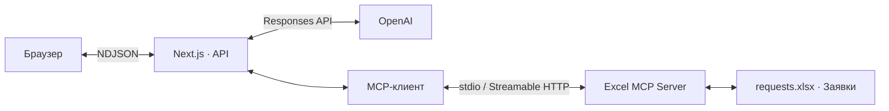

# Архитектура

## Основание проекта

| Материал | Что реализовано |
|---|---|
| ДЗ Pro | Локальный `requests.xlsx`, готовый MCP-сервер, чат, таблица, обновление, три сценария, подтверждение, два случая ошибок, фактический журнал |
| Презентация занятия 9 | Tool Calling по цепочке «список → выбор → вызов → результат → ответ», отдельный слой MCP, визуальная схема, подтверждение и контрольное чтение |
| Промпт для Codex | Только OpenAI, запуск без ключа, адаптер HTTP, защита операций, воспроизведение шагов, тесты и документация. Текущий этап локальный |

## Серверный цикл

1. Route Handler проверяет тело запроса, источник и сессию.
2. MCP SDK устанавливает соединение и получает `tools/list`. Соединение обслуживает одну серверную операцию, включая все вызовы модели и Excel в этой операции.
3. Агент берёт разрешённые имена и описания из каталога. Для OpenAI приложение заменяет низкоуровневые файловые параметры схемами предметной области и добавляет функцию подготовки плана.
4. OpenAI выбирает функцию и аргументы. Приложение проверяет их Zod и передаёт локально вычисленные адреса настоящему MCP-серверу.
5. Приложение передаёт результат в `function_call_output`. OpenAI может сделать ещё один вызов. Бюджет составляет пять обращений к модели и до 48 секунд на серверную операцию.
6. В браузер приходят события и итог. Для записи и плана текст успеха опирается на результат, проверенный приложением.

Маршрут обновления получает данные напрямую из MCP. OpenAI участвует при обработке сообщений чата. При нажатии кнопок подтверждения приложение использует ранее сохранённый серверный план.

## Контроль данных

- Сервер фиксирует книгу в конфигурации и лист «Заявки» в коде. Приложение проверяет заголовки, типы полей, уникальность ID и объём до 1 000 записей.
- Добавление под блокировкой читает лист, выбирает следующий свободный ID и целевую строку. Маркер повтора записывается до изменения книги по ключу сессии и запроса. При повторе сервер проверяет зарезервированный ID и поля через MCP. Запись подтверждает повторное чтение.
- План смены статуса связан с HttpOnly-сессией, действителен пять минут и доступен для одного решения. Подтверждение сверяет всю исходную запись, меняет одну ячейку D и перечитывает лист. При совпадении нескольких имён нужны номера заявок.
- Текст заявки проверяется перед записью. Значения с признаками формулы или автоматического преобразования в дату отклоняются. Содержимое Excel передаётся модели как данные.
- Локальный режим рассчитан на один процесс Next.js и владельца записи. Сериализация внутри процесса покрывает его собственные вызовы. Параллельная запись из Excel или другого процесса в промежутке между чтением и записью остаётся вне этой защиты.
- История чата и планы находятся в памяти. Журнал идемпотентности добавления хранится отдельно в `.runtime/operations`. Книга содержит исходные данные и остаётся источником истины.

## Файлы

| Модуль | Ответственность |
|---|---|
| `app/workspace.tsx`, `app/trace-panel.tsx` | Чат, фильтры, таблица, схема и журнал |
| `app/api/workspace/route.ts` | Маршрут, поток NDJSON и проверка сессии |
| `lib/agent.ts` | OpenAI Responses API и цикл вызовов функций |
| `lib/mcp.ts`, `lib/config.ts` | Адаптер MCP, каталог, белый список и транспорт |
| `lib/workbook.ts`, `lib/operations.ts` | Чтение, валидация, добавление, план и подтверждение |
| `scripts/workbook.ts` | Каталог, создание и сброс демонстрационной книги |
